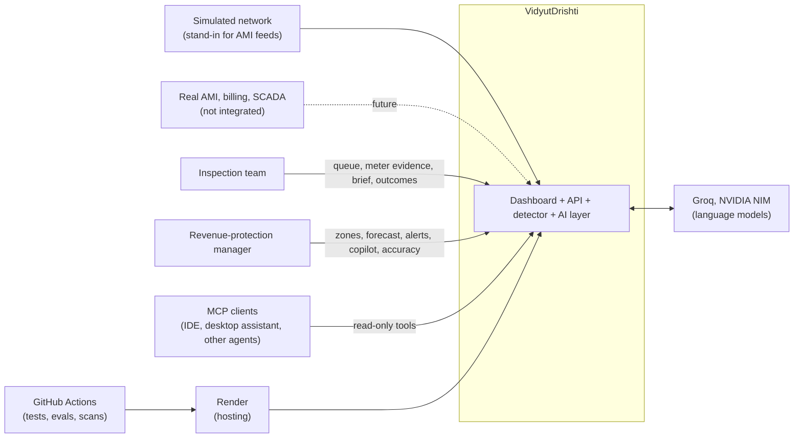
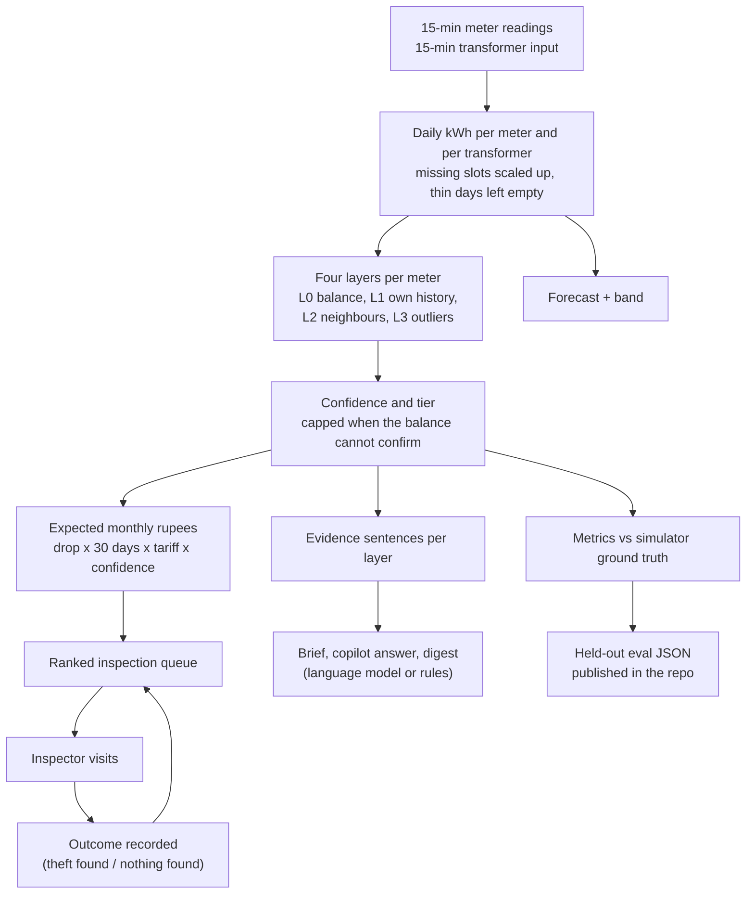

# Detailed High-Level Design

Why VidyutDrishti is built the way it is: the problem, what it sets out to do and not do, how data and decisions flow, where models are and are not allowed to act, and what was traded away. The component picture is in [architecture.md](architecture.md), the module-level detail in [LLD.md](LLD.md) and the measured behaviour in [results.md](results.md).

It is a prototype on simulated data. No claim here is a statement about field performance.

## 1. Problem

Distribution companies lose a large share of the energy they buy to aggregate technical and commercial losses, and electricity theft (hooks on the line, bypassed or stopped meters, slow tampering) is a large part of the commercial side. Smart meters now report every 15 minutes, but inspection teams are small and each visit costs a team-day.

So the useful question is not "is anything wrong somewhere?" but:

> Which few meters should someone visit tomorrow, and what should they look for when they get there?

That implies three requirements on any detector:

1. **A flag has to usually be right.** A false visit costs a team-day and annoys an honest customer.
2. **It has to come with a reason an inspector can check on site**, not a score from a black box.
3. **The list has to be ordered by money a visit is likely to recover**, not by how unusual a meter looks.

There is a fourth, easy to miss: the hardest false alarm is a **vacant house**. Its consumption drops exactly like a theft's. A meter-only detector cannot tell them apart.

## 2. Goals and non-goals

| Goals | Non-goals |
|---|---|
| Score every meter every day and produce a short ranked list | Production deployment against a utility's systems |
| Separate theft from genuine drops using the transformer's energy balance | Proving field accuracy (no labelled real theft data was available) |
| Rank by expected recoverable rupees, with the evidence behind each flag | Accusing anyone: a flag is a reason to visit, not a finding |
| Use language models only where language is the task (briefs, questions, digests), always with a rule-based fallback | Letting a model decide whether a meter is suspicious |
| Measure itself on data it was not tuned on, publish the weak spots | Learning from inspection outcomes (outcomes are recorded and shown; thresholds do not retrain) |
| Run on a small server and degrade gracefully | Horizontal scale, multi-tenancy, authentication and role-based access |
| Be readable by a reviewer: plain-language evidence, shown agent steps | Real tariff slabs, billing integration or legal-grade evidence handling |

## 3. System context

## 4. Components

| Component | Responsibility | Deterministic? |
|---|---|---|
| Simulator | Generates meter and transformer readings with injected thefts and vacant-house decoys, and keeps the ground truth | Yes (seeded) |
| Store | Holds readings in memory, derives daily totals, caches scores per data version | Yes |
| Detector (`scoring.py`) | Four layers, a confidence, a tier, a pattern label, a rupee estimate | Yes, plus a seeded isolation forest |
| Queue and views | Ranks flagged meters, groups by zone, applies inspection outcomes | Yes |
| Forecast | 24-hour feeder demand with an error-based band | Yes (seasonal mean) |
| Evaluation | Scores the detector against ground truth, on the running data and on unseen networks | Yes |
| AI layer | Copilot, inspection brief, alert digest, over eight read-only tools | **No: language models, each with a deterministic fallback** |
| Observability | SQLite log of every model attempt and run | Yes |
| MCP server | The same eight tools for external clients | Yes |
| Dashboard | Plain-language pages over the API, with an app tour | n/a |
| CI and deploy | Tests, held-out eval gate, lint, security scans, gated deploy | Yes |

## 5. Data flow

The direction matters: **data flows from the detector to the AI layer, never back.** A model can read a score; it cannot change one.

## 6. AI versus deterministic boundaries

| Decision | Who makes it | Why |
|---|---|---|
| Is this meter suspicious, and how much? | Rules and a small statistical model (L0 to L3) | Must be testable meter by meter, stable between runs and explainable; a model adds cost and variance and cannot be scored as cleanly |
| Does the transformer confirm the drop? | Subset search over meters' drops (`attribute_gap`) | The physical check that separates theft from vacancy; a closed-form search, not a judgement |
| What goes first in the queue? | Expected rupees (drop x 30 x tariff x confidence) | A formula an operator can audit |
| What do I check on site? | Language model constrained to five fixed causes, with a rule-based brief if it fails | Turning evidence into a plan is language work. The fixed set lets it be scored against ground truth |
| Answers about the network | Language model with eight read-only tools; rules for a fixed set of questions | Every number must come from a tool call, and the calls are shown |
| What counts as an alert, and which meters first? | Rules over day-to-day changes | The model only writes the summary |
| Which provider answers | Failover order (Groq, NVIDIA NIM, rules) | Predictable and logged |
| When to retune thresholds | A person, offline, on development networks | Outcomes are not fed back automatically |

A useful test of the boundary: with every model key removed the application still scores, ranks, forecasts, alerts, writes briefs from rules, answers a fixed set of questions and serves every page. The response says which path produced it.

## 7. Trust and auditability

- **Every flag carries its evidence.** Each layer returns a plain sentence next to its number, for example that the transformer's unmetered share rose from 2.2% to 18.5% of input and that this accounts for the meter's drop. Layers that cannot tell say "inconclusive", not "fine".
- **No single check flags a meter.** L3 adds at most 0.10 to a confidence, and without transformer evidence confidence cannot exceed 0.75.
- **Agent steps are visible.** The copilot and the brief return their full trace: each model turn, each tool call with arguments, latency and a truncated result. The dashboard renders it.
- **Hallucination is measured.** The copilot eval fails any answer that names a meter that does not exist, and counts them.
- **Fallbacks are labelled.** Every AI response carries `mode`, `provider`, `model` and `fallback_reason`.
- **Every model call is logged** (latency, tokens, tool calls, failover, error) and shown on the AI operations page.
- **Accuracy claims are reproducible.** Held-out detection uses networks never used for tuning; the JSON results are committed; CI regenerates them and fails if recall drops below 0.85.
- **Limits are published.** Vacant-house false alarms, weak gradual-tampering labelling and the simulator gap are stated in the README and in [results.md](results.md#limitations-and-what-did-not-work).

What is not audited today: user actions. There is no user model, no log of who viewed or changed what, and feedback is held in memory. A prototype audit logger exists (`audit/logger.py`) but is not wired.

## 8. Scalability

Today: one process, one in-memory store, 48 meters on 8 transformers for 60 days. Seeding peaks around 380 MB, which is why data is built in chunks and a background thread.

| Dimension | Today | What limits it | Next step |
|---|---|---|---|
| Ingestion | Simulated data loaded at start; a batch endpoint exists | The store is a list of frames in one process; a restart loses everything | Real AMI feeds through the prototype ingestion pipeline (quality gate, imputer, idempotent loader) into TimescaleDB, whose schema already exists |
| Scoring | All meters, one pass, cached per date | `score_meters` recomputes the full window; L2 loops per meter; the digest and detection-lag replays score once per day in the window | Score per transformer in parallel (all layers are per transformer); update incrementally each day |
| L0 attribution | Exact subset search | Cost doubles per dropping meter; bounded at 12 candidates, then a proportional fallback | Fine for typical transformers; a heuristic search for crowded ones |
| Baseline | First 14 days of history, fixed | A long history is judged against day one | A rolling or seasonal baseline (not built, and would need re-evaluation) |
| Forecasting | Seasonal mean per feeder | Simple by choice | Chronos-Bolt through ONNX or a small service (about 11% better MASE in the benchmark), weather and holiday inputs |
| AI | Two providers, 20 model requests per visitor per 10 minutes | Provider quotas | Cache briefs (done per data version), budget alerts, per-user limits |
| Operations | SQLite log, Ops page | One file, one instance | A standard metrics and tracing collector with alerts on flag-rate and precision drift |
| Learning | Outcomes recorded, no retraining | Not built | Use outcomes to retune thresholds and measure precision on real visits |

## 9. Failure modes and degradation

| Failure | What the user sees | What keeps working |
|---|---|---|
| No model key | AI features answer from rules; responses say `mode: rules`, `no_llm_provider` | Everything else, including briefs, alerts and a fixed set of copilot questions |
| Groq down or rate-limited | Falls to NVIDIA NIM; the trace shows the failover | All features |
| Both providers down | Rules answers with `agent_failed` | All features |
| Model returns a cause outside the allowed set | Brief replaced by the rules brief | Detector unchanged |
| Server restarted or cold | Pages show "Data loaded" only after seeding; data endpoints answer 503 with a plain message; the front end says the server may be waking | `/health` answers at once |
| Transformer data missing | L0 says it was skipped; confidence capped at 0.75 | Layers 1 to 3 |
| Meter drop smaller than the balance noise | L0 says "inconclusive"; the meter is not cleared | Other layers |
| Missing meter readings | Days scaled by coverage; under half the slots, the day is empty | Scoring |
| Forecast cannot run (under 7 days of data, model error) | 422 or 500 with a plain reason; no curve is invented | Detector |
| Heavy optional dependency missing (Chronos, MCP, Prophet) | Opt-in backend falls back to the seasonal model, or the feature is simply not offered | Default build |
| Logging database unwritable | Nothing visible; the write is skipped | Request completes |
| Cache stale after new data | Not possible by construction: any add clears the cache | |
| Restart loses inspection outcomes | Outcomes disappear | Detector, queue |

## 10. Security

What is in place:

- **Secrets:** model keys are read from environment variables only. `render.yaml` declares them `sync: false` so they are entered in the host's dashboard. Database settings have no defaults in code.
- **Least capability for models:** the AI layer has eight read-only tools. Nothing it can call writes data, changes a score or alters the queue. The same holds for the MCP server.
- **Input validation:** Pydantic models bound request sizes (question 3 to 500 characters, history at most 12 turns of 2,000 characters, notes up to 1,000, non-negative transformer energy); unknown meters get 404; negative readings are dropped.
- **Cost and abuse control:** a per-visitor limit of 20 model-backed requests per 10 minutes when a key is configured, brief caching, and a 25-second provider timeout.
- **Supply chain and code scanning:** CodeQL, OpenSSF Scorecard and Dependabot (grouped monthly) run in CI.
- **Data:** only synthetic data is committed; the real-household comparison reads a public dataset (London Smart Meters, CC BY 4.0) and caches it outside version control.
- **Deploy gate:** Render deploys only after GitHub checks pass.

What is not in place, and should be before real use:

- **Authentication and authorisation.** The API is open. Anyone who can reach it can read the queue, post feedback and push readings through the ingest endpoints.
- **Rate limit identity.** The limit keys on the first `X-Forwarded-For` value; it is meaningful only behind a proxy that sets that header.
- **Audit trail** of user actions (see section 7).
- **Privacy design** for real consumer identifiers, retention and access, which does not apply to synthetic data but would apply on day one with real data.
- **Handling of a flag as evidence.** A flag is a reason to look, not proof; the application says so, but there is no workflow control around it.

## 11. Trade-offs and alternatives rejected

| Decision | Chosen | Alternative considered | Why not the alternative |
|---|---|---|---|
| Who decides a flag | Rules plus a seeded isolation forest | A model deciding from the data | Cannot be tested meter by meter, adds cost and variance, harder to explain |
| Telling theft from vacancy | Transformer energy balance with subset attribution | Meter-only anomaly score | Theft and vacancy look the same from the meter alone; this is why unreadable-balance scores are capped at MEDIUM |
| Ranking | Expected rupees | Anomaly score order | Teams should visit the most valuable meters first |
| Confidence with no transformer evidence | Cap at 0.75 | No cap | Before the cap, held-out precision 0.79 and recall 0.96; after it, 0.82 and 0.93 (commits `99205c5`, `ae368e0`) with the threshold set on development seeds. The cap trades a little recall for honesty |
| Flag threshold | 0.50 | 0.4 to 0.6 | F1 is flat from 0.4 to 0.6; 0.50 favours recall because a missed theft costs more than a wasted visit |
| Feeder forecast | 4-week seasonal mean | Earlier trend-weekly-monthly blend; Prophet; Chronos-Bolt | The blend was the worst of six (MASE 1.52 against 0.83). Chronos is about 11% better but needs PyTorch and does not fit a 512 MB server; it is kept as an opt-in backend |
| Pattern label | Step-versus-ramp fit | Hinge-ramp shape classifier | The alternative scored 0.12 pattern accuracy and was dropped, not shipped |
| Storage | In-memory store | TimescaleDB (built, prototype) | Simpler to run and evaluate end to end on a small host; the cost is that state is lost on restart |
| Metrics shown | Computed against ground truth | Fixed numbers in the API | The first API returned hardcoded precision and recall while the live queue surfaced 7 of 14 injected thefts; replaced in commit `99205c5` |
| LLM providers | Groq, NVIDIA NIM, then rules | One provider | One outage would take down the AI features; rules keep the application useful with no key |
| Brief output | Five fixed causes | Free-text cause | A closed set can be scored against ground truth and cannot invent a cause |
| Learning from outcomes | Record and display only | Online retuning | Not enough real outcomes to retune on, and automatic retuning would invalidate the published held-out numbers |
| Realism | Calibrate the simulator on real London households; report the gap | Claim the simulator is realistic | After calibration quality rose from 61% to 84% but a classifier still separates real from simulated households (AUC 0.98); detection numbers are therefore method validation, not field performance |

## 12. Open questions

- How does detection hold up on real theft labels? None were available.
- Does a fixed first-14-days baseline survive a year of seasonal change?
- Does the transformer-balance layer survive real technical-loss variation, metering error and unmetered legitimate load? The simulator's transformer input is the true load plus a modelled loss, which favours this layer.
- What precision do inspectors actually see, and can outcomes retune the threshold without hiding drift?
