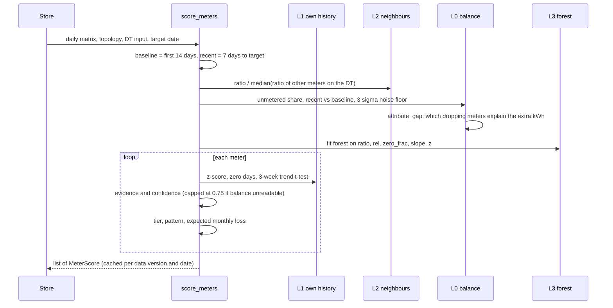
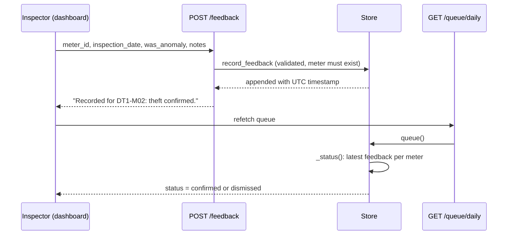
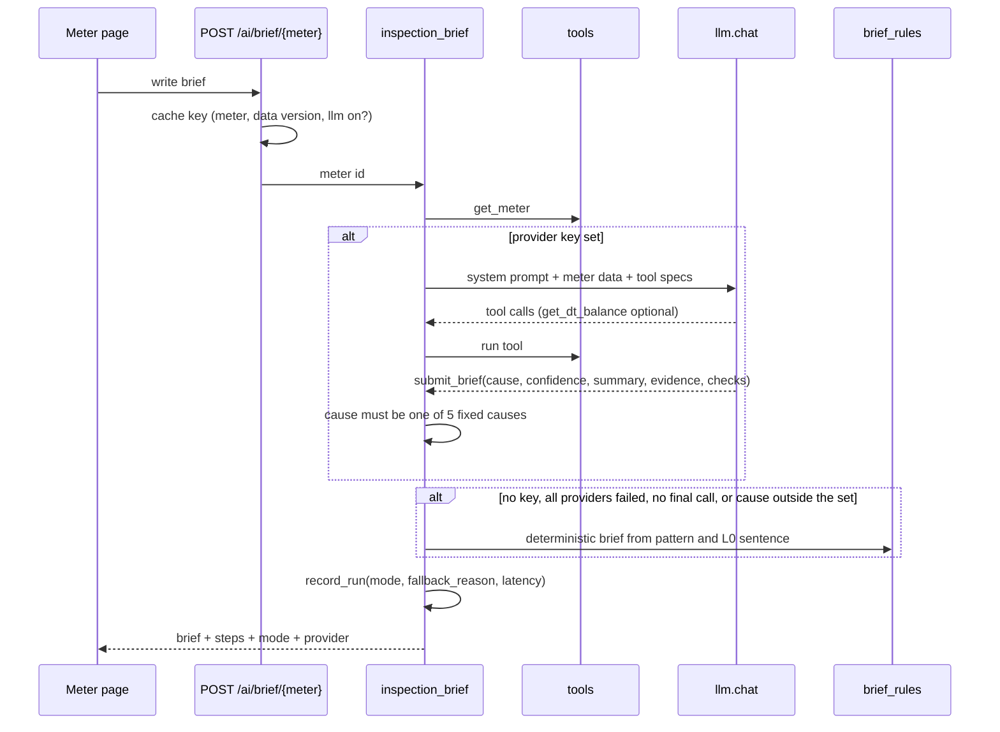

# Detailed Low-Level Design

Module-by-module design of VidyutDrishti as it exists in the repository: key classes and functions with their signatures, the algorithms and formulas, data models, error handling and how each part is tested. The system picture is in [architecture.md](architecture.md); the reasoning and trade-offs are in [HLD.md](HLD.md); measured behaviour is in [results.md](results.md).

All data is simulated. Nothing here has been run against a real utility's meter, billing or SCADA data.

## 0. Live code and prototype code

The repository holds two generations of code. The first build (22 numbered features, see [features.md](features.md) and `logs/`) produced a database-backed pipeline. It was then replaced, for the running application, by a smaller in-memory design that is evaluated end to end. The old modules were kept and are marked here as **prototype**: they have their own prototype-grade tests under `logs/`, but the API does not call them.

| Area | Live (used by the API) | Prototype (kept, not used by the API) |
|---|---|---|
| Ingestion and imputation | `Store.add_*`, `daily_from_slots` | `ingestion/` (quality gate, imputer, idempotent loader, CSV reader, CLI) |
| Forecasting | `forecast/engine.py` | `forecasting/` (Prophet service, scheduler), `risk/` (headroom classifier) |
| Detection | `detection/scoring.py` | `detection/layer0..3_*.py`, `confidence.py`, `classifier.py`, `features/` |
| Loss, queue, feedback | `scoring.rank_queue`, `Store.queue`, `Store.record_feedback` | `evaluation/leakage.py`, `inspection/queue.py`, `feedback/processor.py` |
| Audit | none in the live path (AI call log only) | `audit/logger.py` |
| Database | none (in-memory) | `db/models.py`, `db/migrations`, `db/seed` |

Where this document describes a prototype module it says so.

## 1. Data model

### 1.1 Live, in memory (`store.py`)

| Structure | Shape | Notes |
|---|---|---|
| meter readings | DataFrame `meter_id, ts, kwh` | 15-minute slots; negative values are dropped on entry, NaN is kept as missing |
| DT readings | DataFrame `dt_id, ts, kwh_in` | energy entering each distribution transformer |
| `topology` | `{meter_id: {dt_id, feeder_id, zone}}` | inferred from the id convention `DT<n>-M<nn>`: `DT3-M01` gives `DT3`, `F3`, `ZoneC` |
| `truth` | `{theft: {meter: kind}, theft_start: {meter: date}, decoys: {meter: kind}}` | simulator ground truth, used only by evaluation |
| `feedback` | list of dicts | inspection outcomes; latest per meter sets queue status |
| cache | dict keyed by `(name, data_version[, date])` | cleared whenever data is added |

Simulator convention: each 15-minute value is recorded as `daily_total x diurnal factor`, so one day's 96 slots sum to 96 times the daily total. `Store.slot_scale = 96` is divided out for meters and transformers alike.

### 1.2 Detector output (`detection/scoring.py`)

```python
@dataclass
class Layer:
    name: str            # dt_balance | self_history | peer_comparison | isolation_forest
    fired: bool
    strength: float      # 0..1 before weighting
    value: Optional[float]   # headline number for the layer
    detail: str          # one plain-language sentence

@dataclass
class MeterScore:
    meter_id: str; dt_id: str; feeder_id: str; zone: str; category: str; date: date
    confidence: float; tier: str; flagged: bool
    pattern: str         # flatline | sudden_drop | gradual_decline | consumption_drop | normal
    baseline_kwh: float; recent_kwh: float; drop_pct: float
    est_monthly_loss_inr: float
    layers: List[Layer]
```

### 1.3 API schemas (`api/routes.py`, `api/ai.py`, Pydantic)

`BatchIngestRequest(meter_id, timestamp, kwh, voltage?, pf?)`, `DTIngestRequest(dt_id, timestamp, kwh_in >= 0)`, `BatchIngestResponse(records_received, records_valid, records_written)`, `FeedbackRequest(meter_id, inspection_date, was_anomaly, actual_kwh_observed?, notes? max 1000)`, `FeedbackResponse(success, message)`, `ROIProjection(...)`, `Turn(role in user|assistant, content max 2000)`, `CopilotRequest(question 3..500 chars, history max 12 turns, use_llm)`.

### 1.4 AI call log (`ai/observability.py`, SQLite)

Two tables in a single file (`OBS_DB_PATH`, default `backend/observability.db`).

| Table | Columns |
|---|---|
| `llm_calls` | `id, ts, session_id, purpose, provider, model, status (ok/error/skipped), error, latency_ms, prompt_tokens, completion_tokens, tool_calls` |
| `triage_runs` | `id, ts, session_id, decision_path (agent/rules), label (copilot/brief/digest), escalated, red_flags, fallback_reason, latency_ms, llm_calls, tool_calls, source` |

`escalated` and `red_flags` are always written as `0` and `[]`; they are left over from the table's origin and nothing reads them except the summary's `escalations` count, which is therefore always 0.

### 1.5 Database schema and migrations (prototype)

`backend/app/db/models.py` (SQLAlchemy) and `db/migrations/versions/0001_initial.py` (Alembic) describe a TimescaleDB schema. The running API does not use it. The only code that does is the prototype ingestion CLI (`python -m app.ingestion.cli`) and `docker-compose.yml`'s `timescaledb` service. Migration verification was lexical only (the tests check that the migration script contains the expected calls); it was not executed against a live TimescaleDB in this repository's checks (see `logs/03-timescaledb-schema/errors.md`, E03-002).

| Group | Tables |
|---|---|
| Dimensions | `feeder`, `dt`, `consumer`, `tariff_slab`, `holiday` |
| Hypertables (7-day chunks) | `meter_reading (meter_id, ts, kwh, voltage, power_factor, source, imputed)`, `dt_reading (dt_id, ts, kwh_in)` |
| Analytics | `forecast`, `zone_risk`, `feature_daily`, `flag (layer L0..L3, evidence_json)`, `confidence`, `inspection` |
| Operations | `audit_log`, `ingest_errors`, `injected_events` (simulator ground truth), `job_run` |

The migration also defines three continuous aggregates, a 30-day compression policy and a 365-day retention policy on the two hypertables. `db/seed/` holds `tariff_slab.yaml` (illustrative slab rates, noted in the file as prototype estimates) and `holidays.yaml`. **The live detector does not read these tariff slabs.** It uses the flat per-category tariffs in `scoring.py`.

## 2. Ingestion and imputation

### 2.1 Live

Ingestion is `Store.add_meter_frame(df)`, `add_dt_frame(df)` and `add_readings(rows)`, reached through `POST /api/v1/ingest/batch` and `/ingest/dt-batch`, or directly by `demo_seed._seed()`.

- Columns are narrowed, `ts` is parsed to datetime, and rows with negative `kwh` are dropped (NaN is allowed and means "missing").
- Topology is inferred for any new meter id. Ids that do not match `DT<n>-...` go to `DT0 / F0 / Unassigned`.
- Each add increments `_version` and clears the cache, under an `RLock`.

Missing readings are handled where daily totals are formed, not by filling them in:

```python
def daily_from_slots(readings: pd.DataFrame, slots_per_day: int = 96, min_coverage: float = 0.5) -> pd.DataFrame
```

For each meter and day, `coverage = observed_slots / 96`. If `coverage >= 0.5` the day's kWh is `sum / coverage` (the observed total scaled up); otherwise it is `NaN`. The reason is stated in the docstring: a missing reading must not look like energy that went unmetered at the transformer, because that is exactly what Layer 0 looks for. NaN days are excluded from means and counted as "near zero" in the zero-usage share.

### 2.2 Prototype pipeline (`ingestion/`)

```
CSVReader (batches) -> apply_quality_gate(df, TableSpec) -> impute_meter_readings -> load_* (INSERT ... ON CONFLICT DO NOTHING)
```

- `apply_quality_gate(df, spec) -> QualityResult(clean, rejected, n_input)`: rejects whole batch on missing required columns, otherwise rejects rows with nulls where not allowed or values outside `min_value`/`max_value`, each with a reason string (`null_<col>`, `below_min_<col>`, `above_max_<col>`).
- `impute_meter_series(df, slot_minutes=15) -> ImputeResult`: a gap of at most 60 minutes is linearly interpolated; 61 to 360 minutes takes the meter's mean for that slot of the day; longer gaps stay NaN on purpose ("the meter had an outage; skip detection rather than raise a false positive"). Imputed rows are flagged `imputed = True`.
- Loaders are idempotent; `record_rejects` writes to `ingest_errors`; `PipelineReport` counts rejected and imputed rows.

## 3. Detection layers (L0 to L3)

All four layers are computed together in `score_meters`:

```python
def score_meters(daily: pd.DataFrame, topology: pd.DataFrame, target_date: Optional[date] = None,
                 dt_input: Optional[pd.DataFrame] = None, baseline_days: int = 14,
                 recent_days: int = 7) -> List[MeterScore]
```

`daily` is `meter_id, date, kwh`; `topology` is `meter_id, dt_id, feeder_id, zone`; `dt_input` is `dt_id, date, kwh_in`. The function pivots to a meters-by-days matrix, truncates it at `target_date` (so any past day can be scored) and returns `[]` if fewer than `baseline_days + recent_days` (21) days exist.

Windows: **baseline** is the first 14 days of the history; **recent** is the 7 days ending at `target_date`. The baseline is therefore a fixed early window, not a rolling one. A theft that starts inside the first 14 days contaminates its own baseline, and slow drift over many weeks is judged against day one.

Per-meter quantities: `base_mean`, `base_std`, `recent_mean`, `ratio = recent_mean / base_mean` (1.0 if undefined), `zscore = (recent_mean - base_mean) / base_std`, `zero_frac` (share of the recent days below 5% of `base_mean`, or NaN), and `drop = clip(1 - ratio, 0, 1)`.

### 3.1 L1: own history

```
l1_strength = max( clip((drop - 0.2) / 0.6)  if zscore <= -1.5 else 0,
                   clip((zero_frac - 0.3) / 0.5) )
fired = l1_strength >= 0.25
```

A 3-week trend test then lets a slow decline raise the strength even when the weekly mean has not yet fallen far: fit a line to the last 21 days; `decline = -slope x 20 / base_mean`; `t = -slope x sqrt(Sxx) / residual_sd`. If `t > 3`, `trend_drop = clip((decline - 0.15) / 0.35)`, and `l1_strength = max(l1_strength, trend_drop)`. The headline `value` is the z-score.

### 3.2 L2: neighbours

For each transformer, take the ratio of every other meter on it and use their median:

```
rel = ratio / median(ratio of the other meters on the same DT)      (ratio itself if the median is 0)
l2_strength = clip((0.85 - rel) / 0.6)
fired = l2_strength >= 0.25
```

Weather, festivals and a transformer-wide outage hit all neighbours, so they cancel in `rel`. Value shown: `100 x (rel - 1)` percent.

### 3.3 L0: transformer balance

Per transformer and day, `share = (kwh_in - sum(metered)) / kwh_in`. Technical losses scale with load, so shares are compared, not kWh.

```
base_share  = mean(share over baseline days)
rec_share   = mean(share over recent days)
rec_in      = mean(kwh_in over recent days)
extra       = max(0, (rec_share - base_share) x rec_in)            # extra unmetered kWh/day
noise_kwh   = 3 x std(share over baseline days) x rec_in / sqrt(recent_days)
drops[m]    = base_mean[m] - recent_mean[m]   if that is more than 20% of base_mean[m], else 0
explained   = attribute_gap(extra, drops)
```

Per meter:

- If the meter's own drop is smaller than `noise_kwh`, the layer is **inconclusive** (`explained = None`): "too small to see in the energy balance". It is never reported as "fine".
- Otherwise `explained[m]` is the meter's attribution score and the layer fires when `explained >= 0.5` and the meter has a drop.
- If no transformer input exists, the layer is skipped with a stated reason (`explained = None`).

`attribute_gap(gap, drops, tolerance=0.15) -> Dict[str, float]` decides which dropping meters account for the extra unmetered energy:

1. Candidates are meters with `drop > 0`. If `gap <= 0` or there are none, everyone scores 0.
2. With more than 12 candidates it falls back to a proportional share `clip(gap / sum(drops))` (the subset search is bounded at 2^12 - 1 subsets).
3. Otherwise it enumerates every non-empty subset and computes `|gap - sum(drops in subset)|`. `best_err` is the minimum; the near-best set is every subset within `best_err + 0.15 x gap`.
4. `quality = clip(1 - best_err / gap)`. A meter's score is `quality x (share of near-best subsets that contain it)`, rounded to 3 places. Two equally good explanations therefore each get partial credit.

The point of the layer: stolen energy is still drawn through the transformer, so a theft opens a gap equal to the meter's drop; a vacant house shrinks metered and supplied energy together and opens none.

### 3.4 L3: isolation forest

Features per meter: `ratio, rel, zero_frac, slope, z` where `slope` is the normalised 6-week trend slope (`polyfit` over the span from day 14 or `end - 42`, divided by `base_mean`, needs 5 points) and `z` is the z-score clipped to +/-20. With at least 10 meters:

```
IsolationForest(n_estimators=200, contamination="auto", random_state=0)
raw = -score_samples(features)                       # higher = more anomalous
l3_strength = clip((raw - median(raw)) / (max(raw) - median(raw)))
fired = l3_strength >= 0.6
```

The forest is fitted fresh on the current day's feature matrix (no stored model). It adds at most 0.10 to a confidence, so it can never flag a meter by itself.

### 3.5 Confidence engine (live)

```
evidence = max(l1_strength, 0.8 x l2_strength)

if the balance is readable (explained is not None):
    conf = evidence x (0.25 + 0.55 x explained) + 0.10 x l2_strength + 0.10 x l3 x explained
else:                                  # no DT data, or the drop is below the noise floor
    conf = evidence x 0.5 + 0.15 x l2_strength + 0.10 x l3         # maximum 0.75

conf = round(clip(conf), 3)
tier = HIGH if conf >= 0.80 else MEDIUM if conf >= 0.65 else REVIEW if conf >= 0.50 else NORMAL
flagged = conf >= 0.50                                              # FLAG_THRESHOLD
```

`FLAG_THRESHOLD = 0.50` was chosen on development seeds 0 to 19, not on the held-out seeds. The cap at 0.75 was added in commit `ae368e0` after noticing that without readable transformer evidence a theft and a vacancy look the same; see [results.md](results.md) for its effect.

Prototype counterpart: `detection/confidence.py` (`ConfidenceEngine`, `LayerSignals`) is a flat weighted sum, L0 0.10 + L1 0.30 + L2 0.30 + L3 0.30, with each layer's score being `min(1, |magnitude| / threshold)` when its flag fired. It has no transformer-evidence cap. The live engine replaced it.

### 3.6 Behavioural classifier (pattern label)

```python
def classify_shape(series: np.ndarray, base: float) -> str   # "sudden_drop" | "gradual_decline" | "consumption_drop"
```

The series is divided by `base`. For every split point `k`, a **step** model (two constant levels) and a **ramp** model (constant level, then a downward linear fit) are compared by squared error. The pattern is `gradual_decline` if the best ramp error is below 0.8 times the best step error, otherwise `sudden_drop`. In `score_meters`: `flatline` if `zero_frac >= 0.6`; else the shape label if `drop >= 0.3`; else `normal`.

This label is the only behavioural classification in the live path. The inspection brief uses it as input. Measured accuracy of the label for gradual tampering is low (15% on the held-out set); see [results.md](results.md#limitations-and-what-did-not-work).

Prototype counterpart: `detection/classifier.py` (`BehaviouralClassifier`, `AnomalyType`) labels from day-level metrics (zero-slot ratio over 90%, rolling-mean ratio under 0.5, day-over-day change under -40%, spikes over 50%, coefficient of variation over 0.5). A reworked hinge-ramp shape classifier was tried in the live path and was worse (0.12 pattern accuracy), so it was dropped (see [SIMULATOR_REALISM.md](SIMULATOR_REALISM.md)).

### 3.7 Sequence



## 4. Leakage quantification and ranking

Live:

```
category      = industrial if base_mean >= 100, commercial if >= 25, else domestic      # kWh/day
tariff        = {domestic: 6.0, commercial: 9.0, industrial: 8.0} INR/kWh                 # assumed, flat
loss_if_true  = max(0, base_mean - recent_mean) x 30 x tariff
est_monthly_loss_inr = round(loss_if_true x confidence)
```

```python
def rank_queue(scores: List[MeterScore], limit: int = 20) -> List[MeterScore]
```

Flagged meters sorted by `(-est_monthly_loss_inr, -confidence)`. The queue is therefore ordered by expected recoverable rupees, not by how unusual a meter looks.

Prototype: `evaluation/leakage.py` (`LeakageQuantifier`) estimates kWh lost from peer deviation first, otherwise from the z-score method capped at 3 standard deviations, times a default tariff of 7.50 INR/kWh. Not used.

## 5. Inspection queue and feedback loop

### 5.1 Queue (live)

`Store.queue(target=None, limit=20)` returns one dict per ranked meter: rank, ids, `confidence`, `tier`, `pattern`, `estimated_inr_lost`, `drop_pct`, baseline and recent kWh, `layers_fired`, a one-line description (`"<n>% below its own baseline; <k> of 4 layers agree"`) and `status`.

Status is derived, not stored on the queue: `Store._status(meter_id, date)` scans feedback from the newest and returns `confirmed` if the latest outcome says theft was found, `dismissed` if nothing was found, else `pending`. Because scores are recomputed from data and status is looked up at read time, a feedback submission needs no cache invalidation.

`zones()` groups scores by zone (one transformer per zone): flagged count, HIGH count, summed loss, and a zone risk of `HIGH` if any HIGH meter, `MEDIUM` if two or more flagged, `REVIEW` if one, else `LOW`. `overview()` adds counts by tier and pattern, how many meters each layer fired on, and a 10-bucket confidence histogram.

Prototype: `inspection/queue.py` (`InspectionQueue.generate/assign/complete/dismiss`) with a max size of 100 and a minimum confidence of 0.5, sorted by confidence then rupees.

### 5.2 Feedback loop

`POST /api/v1/feedback` validates the body, rejects unknown meters with 404 and calls `Store.record_feedback`, which appends the record with a UTC timestamp. Outcomes change queue status and are counted in `evaluation()["field_feedback"]` (confirmed and dismissed). **They do not retrain or retune any threshold.** That is a stated limit, not an oversight.

Prototype: `feedback/processor.py` (`FeedbackProcessor`) computes precision, recall and F1 from inspection history and `suggest_threshold_adjustment` moves the threshold by 0.1 (bounded 0.3 to 0.9) when precision falls below a target of 0.8 or recall below 0.7. Not wired.



## 6. Forecasting

Live: `forecast/engine.py`.

```python
def seasonal_mean(values: np.ndarray, slots_per_day: int, steps: int, weeks: int = 4) -> np.ndarray
class FeederForecaster:
    def fit(self, df) -> FeederForecaster          # df: timestamp, feeder_id, kw (15-minute slots)
    def predict(self, feeder_id, horizon_hours=24, resolution_minutes=15) -> FeederForecast
```

- **Point forecast:** for each of the next 96 slots, the mean of the same slot 1, 2, 3 and 4 weeks earlier (only lags that exist). It needs at least 7 days of history.
- **Band:** replay the same model for each of the last 14 days, compute relative errors `(actual - pred) / pred` where `pred > 0`, and take their 10th and 90th percentiles `(lo, hi)`. Each forecast point gets `[y x (1 + lo), y x (1 + hi)]`; the lower end is clamped at zero. With too little history to replay, a stated flat band of -20% / +20% is used.
- **Optional Chronos-Bolt:** `FORECAST_MODEL=chronos` tries a pretrained model (`CHRONOS_MODEL`, default `amazon/chronos-bolt-tiny`) and falls back silently to the seasonal mean if torch or weights are unavailable. The response names the model that actually ran.
- **Zone risk from the forecast:** peak versus a placeholder capacity of 5000 kW: HIGH at 88% utilisation or more, MEDIUM at 75% or more. The capacity is a placeholder "until the asset registry supplies real ratings".

Route `GET /api/v1/forecast/{feeder_id}`: 404 for an unknown feeder, 422 under 7 days of readings, 500 with the exception type name if the model fails (it reports rather than inventing a curve). Readings use the simulator's per-slot convention, so kW is derived as `slot_value / (slot_scale / 4)`.

Benchmark and why this model was chosen over the previous one and over Chronos: [FORECAST_BENCHMARK.md](FORECAST_BENCHMARK.md). Prototype: `forecasting/` (Prophet service with training, backtest and scheduler) and `risk/classifier.py` (headroom: HIGH below 10%, MEDIUM below 25%).

## 7. Audit logging

Live: there is no audit trail of user actions. What exists is the **AI call log** (section 1.4): every model attempt (success, error or skipped provider) with provider, model, latency, token counts, tool-call count, the session and the purpose (`copilot`, `inspection_brief`, `alert_digest`), plus one run row per feature call with the decision path (`agent` or `rules`) and the fallback reason. `record_*` swallow `sqlite3.Error` so observability can never break a request. Every agent response also returns its own `steps` trace (each model turn and each tool call with arguments, latency and a truncated result), which the dashboard renders.

Prototype: `audit/logger.py` (`AuditLogger`, `AuditEvent`, `AuditAction`, `AuditLevel`) logs meter and queue access, feedback, ingestion, threshold changes and security events, with level filtering, query and CSV export. In memory only; not wired.

## 8. AI agents and tools

### 8.1 Tools (`ai/tools.py`)

Eight read-only functions, each returning a compact JSON-able dict computed from the store:

| Tool | Returns |
|---|---|
| `get_overview()` | meters, flagged, pending, monthly loss, zones at risk, counts by tier and pattern |
| `list_zones()` | per zone: risk, meters, flagged, HIGH count, loss |
| `get_queue(limit=10, zone=None, tier=None)` | ranked items (limit capped to 50) |
| `find_meters(zone, tier, pattern, min_drop_pct, flagged_only)` | matching meters (first 40) |
| `get_meter(meter_id, days=42)` | score, each layer's detail sentence, daily kWh next to the peer median |
| `get_dt_balance(dt_id, days=28)` | daily input, metered and unmetered percent for a transformer |
| `detection_quality()` | the held-out numbers read from `evals/results/detection.json`, plus this dataset's scores against ground truth |
| `get_alerts(days=7)` | recent alerts (days capped to 14, first 25) |

`TOOLS` maps name to function; `SPECS` holds the OpenAI-style function schemas. `run(name, args)` drops arguments that start with `_`, returns `{"error": ...}` for an unknown tool or bad arguments and never raises to the agent.

### 8.2 Provider client (`ai/llm.py`)

```python
def chat(messages, tools=None, temperature=0.2, max_tokens=900) -> Optional[ChatResult]
```

Providers are tried in order: Groq (`GROQ_MODEL`, default `openai/gpt-oss-120b`), then NVIDIA NIM (`NVIDIA_NIM_MODEL`, default `openai/gpt-oss-20b`). A provider with no key is skipped. Each attempt has a 25-second timeout. Any exception (network, HTTP status, malformed body) is caught, described (`HTTP 429`, `timeout`, exception name), appended to `ChatResult.errors` and logged to SQLite and to the application log; the next provider is tried. If none answers, `chat` returns `None`. Tool-call arguments that are not valid JSON are kept as `{"_raw": ...}` instead of failing. `transport` is a module-level hook that tests replace.

### 8.3 Agent loop (`ai/agents.py`)

```python
def run_loop(system, user, tool_names, final_tool, trace, max_tokens=900) -> Optional[Dict]
```

Up to `MAX_TURNS = 6` model calls. Each turn: call the model with the allowed tool specs plus a final tool; execute requested data tools and feed their JSON back; stop when the model calls the final tool (`final_answer` for the copilot, `submit_brief` for the brief). If a turn has no tool call the model is nudged once to call the final tool. If it still answers in plain text after using tools, the copilot accepts that text (marked `plain`), the brief does not. Every step is appended to `trace`.



### 8.4 Copilot and brief

- `copilot(question, history=None, use_llm=True, session_id=None)`: the agent path uses the last 6 history turns and the 8 tools; the system prompt says to use only fetched numbers and never invent meters or zones. The rules path (`copilot_rules`) pattern-matches a meter id, zone-loss, accuracy, transformer or zone balance, queue, and overview questions and answers from the same tools; anything else returns a message listing the questions it can answer. The response always carries `mode` (`agent` or `rules`), `fallback_reason` (`no_llm_provider`, `llm_disabled` or `agent_failed`), `steps` and `latency_ms`.
- `inspection_brief(meter_id, use_llm=True, session_id=None)`: causes are the fixed set `hook_bypass, gradual_tampering, meter_stopped, genuine_drop, inconclusive`; each has fixed field checks and the response adds a fixed safety note. `brief_rules` maps the detector's output to a cause: a balance layer that says the drop "looks genuine" gives `genuine_drop`; `flatline` gives `meter_stopped` when recent use is at most 2% of baseline, else `hook_bypass`; `sudden_drop` gives `hook_bypass`; `gradual_decline` gives `gradual_tampering`; anything else `inconclusive`. Confidence band: high at 0.8 or more, medium at 0.6 or more, else low.

### 8.5 Alerts and digest (`ai/alerts.py`)

`alerts(days=7)` replays scoring for each day in the window against the day before and emits, de-duplicated:

| Type | Rule |
|---|---|
| `new_flag` | a meter crosses the 0.50 threshold |
| `escalation` | a flagged meter rises above the highest tier already reported for it |
| `cleared` | a flagged meter drops back below the threshold |
| `balance_jump` | a transformer's unmetered share rises 5 points or more over a week earlier (critical at 15 or more) |

`digest(days=1, use_llm=True)` asks a model to summarise the alert list in at most 110 words using only listed facts; without a model, or if it fails, `_template_digest` builds the text from the same list. The model never decides what is an alert.

## 9. MCP server

`mcp_server.py` uses `FastMCP("vidyutdrishti")`. `build_server()` registers every entry of `tools.TOOLS` with the description from `tools.SPECS`, wrapped by `_typed` so annotations are resolved (`tools.py` uses postponed annotations and older MCP SDKs cannot read string annotations; fixed in commit `82caaa1`). `main()` runs `demo_seed._seed()` synchronously, then serves over stdio. It needs the optional extra: `pip install -e "backend[mcp]"`.

## 10. API routes

Base path `/api/v1`. `GET /health` is at the root and does not touch data.

| Method and path | Purpose | Errors |
|---|---|---|
| `POST /ingest/batch`, `POST /ingest/dt-batch` | push 15-minute meter or transformer readings | 422 on a bad body |
| `GET /overview`, `/queue/daily`, `/meters`, `/meters/{id}/status`, `/zones/summary`, `/dt/balance` | detector views, optional `target_date` | 503 while data is loading; 404 unknown meter |
| `POST /feedback` | record an inspection outcome | 404 unknown meter |
| `GET /forecast/{feeder_id}` | 24-hour forecast with band | 404, 422, 500 |
| `GET /metrics/evaluation` | this dataset against ground truth (`demo`) and the held-out report (`held_out`) | |
| `GET /metrics/roi` | illustrative ROI; every input is an assumption listed in the response | |
| `GET /ai/status` | configured providers, models, rate limit | |
| `POST /ai/copilot`, `POST /ai/brief/{meter}`, `GET /ai/alerts`, `GET /ai/alerts/digest` | AI features | 429 when over the rate limit; 404 unknown meter |
| `GET /ai/ops/summary`, `/ops/calls`, `/ops/runs`, `/ops/timeseries` | AI call log views | |
| `GET /ai/evals` | AI eval results per mode, without per-case rows | |

Rate limiting (`api/ai.py`): 20 model-backed requests per visitor per 600 seconds, keyed by the first `X-Forwarded-For` address, applied only when a provider key is configured. Brief responses are cached on `(meter, data_version, llm_enabled)` and `?refresh=true` bypasses the cache. AI work runs in a threadpool so it does not block the event loop. The ROI endpoint is the one place with invented-in-advance inputs: 8.5 million consumers, 1.5% prevalence, a platform cost of 15 crore a year, 65% fewer wasted inspections ("assumed, not measured") and a 10% discount rate over five years.

CORS origins come from `CORS_ORIGINS` (default the two local dev origins).

## 11. Simulator and evaluation harness

### 11.1 Simulator (`simulator/`)

`build_dataset(cfg: SimConfig) -> dict` returns meter readings, transformer input, consumers and the injected events (ground truth). Per meter: a category daily mean and standard deviation, a 24-hour diurnal shape (normalised to mean 1.0 at slot level), season, weekend and holiday multipliers, and multiplicative noise. Then theft or decoy functions in `scenarios.py` are applied: `hook_bypass` multiplies a window by `1 - severity`, `gradual_tampering` applies a linear ramp to `severity`, `meter_stop` sets zeros, `vacancy` multiplies by `1 - severity`, `equipment_fault` zeros. Missing readings are injected at the configured rates.

The transformer input is built from the **true** load plus a technical loss, not from the post-theft metered sum (commit `66267d0`). That is what makes a theft open a balance gap and a vacancy not. It is also a modelling choice that favours the transformer-balance layer; see [results.md](results.md#limitations-and-what-did-not-work).

Realism knobs (`SimConfig.realism`, set from `simulator/calibrated_realism.json`): `ar1_phi, cv_mult, meter_cv_sigma, base_load_frac, shape_jitter, timing_shift_hours, spike_sigma, lognormal_daily`. With no knobs the simulator behaves exactly as the original.

### 11.2 Evaluation scripts (`evals/`)

| Script | Does |
|---|---|
| `detection_eval.py` | `random_network(seed)` places 11 thefts (kinds drawn 50% hook bypass, 30% gradual, 20% meter stop; start day 18 to 40) and 4 vacancy decoys on 8 transformers x 6 meters x 60 days, scores with `score_meters`, and reports precision, recall, F1, precision at 10, sweep, per-kind recall and decoys flagged. `--simulator original|calibrated` (default calibrated), `--first-seed`, `--gate-recall` |
| `ai_eval.py` | rules or agent mode over unseen networks: brief cause against ground truth, copilot answers against values computed from the same data, plus a count of invented meter ids |
| `realism_eval.py`, `calibrate_simulator.py`, `real_data.py` | compare simulator households with real London households (10 scale-free features, SDMetrics quality, classifier AUC, Wasserstein distance); calibrate on shard 498, score on shard 499 |
| `forecast_benchmark.py` | day-ahead benchmark on feeders built from real households |

`evaluation/live.py::compute(scores, theft, decoys, queue_ids, threshold)` is the shared metric function; `detection_lag_days` measures days from theft start to first flag.

## 12. Frontend (`frontend/src`)

React 18, TypeScript, Vite, React Router, TanStack Query, Recharts, Leaflet. `api.ts` wraps `fetch` with `API_BASE` (`VITE_API_BASE`, empty in local dev where the Vite proxy forwards `/api`), turns failures into `ApiError(status, message)` and gives a plain message when the server cannot be reached ("it may be waking up").

| Route | Page | Data it reads |
|---|---|---|
| `/` | Landing | `/metrics/evaluation` |
| `/app` | Dashboard (overview): loss estimate, top five queue entries, transformer balance, morning digest | overview, queue (5), balance (7 days), zones, digest |
| `/app/queue` | Inspection queue (filters: tier, zone, status; outcome buttons post feedback) | queue; mutation invalidates queue queries |
| `/app/meters/:id` | Meter detail: usage against peers and baseline, per-layer evidence, "write inspection brief", outcome form | `/meters/{id}/status`, balance (30 days); mutations on `/ai/brief/{id}` and `/feedback` |
| `/app/zones` | Zones and transformers: map, transformer diagram, forecast | zones, meters, balance (7 days), `/forecast/{feeder}` (no retry) |
| `/app/alerts` | Alerts and morning digest, filterable by window and type | `/ai/alerts`, `/ai/alerts/digest` (5-minute stale time) |
| `/app/copilot` | Ask the data, with agent steps shown (`Trace`) | mutation on `/ai/copilot` |
| `/app/quality` | Accuracy and ROI: held-out metrics, sweep, AI evals, ROI assumptions | `/metrics/evaluation`, `/ai/evals`, `/metrics/roi` |
| `/app/ops` | AI operations | `/ai/ops/*`, refetched every 30 seconds |

State is server state held by TanStack Query (`lib/queries.ts` hooks: `useOverview`, `useQueue`, `useMeters`, `useMeter`, `useZones`, `useBalance`, `useAiStatus`, `useAlerts`, `useDigest`); local UI state (filters, the open mobile menu, whether the tour is open) is `useState`. Pages are lazy-loaded. `components/Tour.tsx` is an eight-step docked guide, opened by the "Take the app tour" button or `?tour=1`; the page stays visible beside it.

## 13. Error handling summary

| Failure | Behaviour |
|---|---|
| Negative reading on ingestion | dropped (store) or 422 (transformer reading, `ge=0`); never stored |
| Missing slots | day scaled by coverage; under 50% coverage the day is NaN |
| No transformer data | L0 skipped with a stated reason; confidence capped at 0.75 |
| Drop smaller than the balance noise floor | L0 "inconclusive", cap applies |
| Data not loaded yet | 503 "still loading" |
| Unknown meter, feeder or transformer | 404 or a tool error dict with the id format hint |
| Less than 7 days to forecast | 422 |
| Forecast model raises | 500 naming the exception type; no invented curve |
| Provider error, timeout, bad body | recorded, next provider tried, then rules |
| Tool call with bad arguments | error dict returned to the model, not raised |
| Brief cause outside the five allowed | discarded, rules brief used |
| Model replies without finishing in 6 turns | rules answer (brief) or accepted plain text (copilot) |
| SQLite log write fails | swallowed; the request continues |
| Over the AI rate limit | 429 with a plain message |
| Optional heavy dependency missing (Chronos, Prophet, MCP) | opt-in path falls back or the test skips |

## 14. Test strategy

37 backend tests plus 8 end-to-end tests; all pass. CI runs them without network access.

| File | Count | What it pins down |
|---|---|---|
| `backend/tests/test_scoring.py` | 14 | theft with a transformer gap is flagged HIGH; vacancy without a gap is not flagged; theft and vacancy on the same transformer are told apart; a small theft on a big transformer is **inconclusive, not cleared**; no DT data skips L0; flatline and ramp labels; normal meters stay quiet; queue ranks by expected rupees; too little history returns nothing; scoring a past date; `attribute_gap` picks the matching subset; `classify_shape`; `daily_from_slots` scaling; tier cut points |
| `backend/tests/test_store_api.py` | 6 | topology inference; store views (queue, evaluation, detection lag, meter series, zones, overview, balance); feedback changes status; negative readings rejected through the API path; endpoints through an ASGI client; empty store says "loading" |
| `backend/tests/test_ai.py` | 10 | tools return store numbers; copilot agent uses tools and answers; provider failover then rules; rules without a key; brief agent and cause validation; rules brief; alerts and digest without a model; digest with a model; AI API; rate limit |
| `backend/tests/test_forecast.py` | 3 | recovers a pure weekly pattern; full day with an ordered, non-negative band; refuses under a week of history |
| `backend/tests/test_mcp_server.py` | 3 | server exposes exactly the copilot's tools; descriptions match the copilot specs; `get_meter` requires `meter_id` |
| `backend/tests/test_realism.py` | 1 | calibrated knobs load and are numeric |
| `tests/e2e/test_end_to_end.py` | 8 | prototype pipeline integration (ingestion components, layers, inspection queue, evaluation harness) and the presence of the compose and Docker files. **It does not call the live API**; the API is covered by `test_store_api.py` and `test_ai.py` |

Design choices that keep tests honest:

- `tests/conftest.py::make_network` builds a tiny network with a chosen theft (step or ramp) and vacancy per meter, transformer technical loss with day-to-day jitter, and a fixed seed.
- The LLM is replaced by a scripted transport (`Script` in `test_ai.py`) that returns canned replies or raises, so failover, tool loops and validation are tested with no network and no key.
- The same detector code is used by the application, the tests and the held-out evaluation; there is no separate "eval" scorer.
- Held-out evaluation (`evals/detection_eval.py`) uses seeds 1000 to 1019; thresholds were tuned on seeds 0 to 19.
- CI gates: recall at least 0.85 on 20 held-out networks; the AI rules baseline is regenerated; the agent eval runs only if a key secret exists. Quality gates are ruff, vulture, radon/xenon and jscpd on the live modules; prototype modules are excluded from lint rather than hidden.

Prototype modules carry their own tests (7 to 20 per feature) under `logs/NN-*/tests` with a `test_review.md` each.
