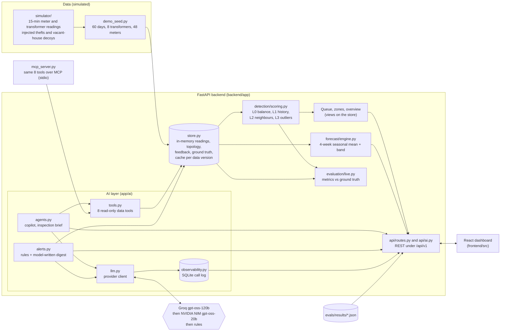
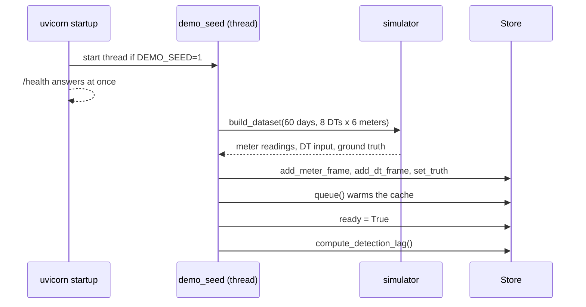
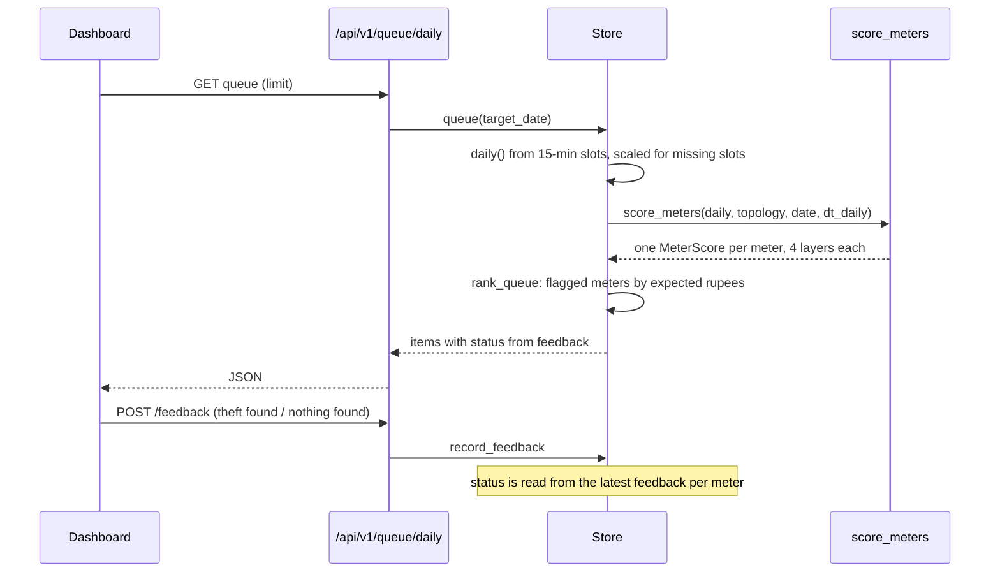
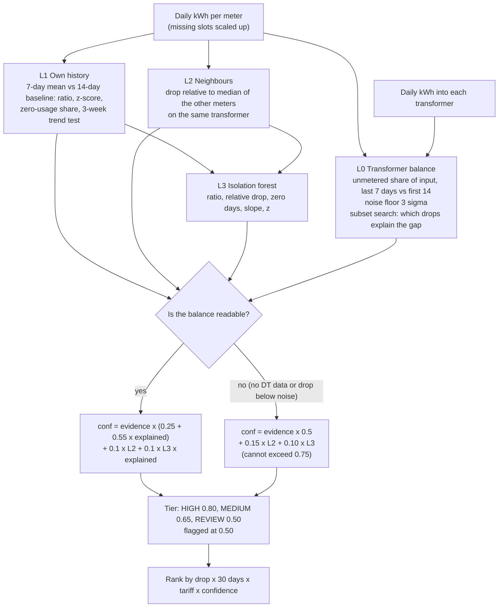
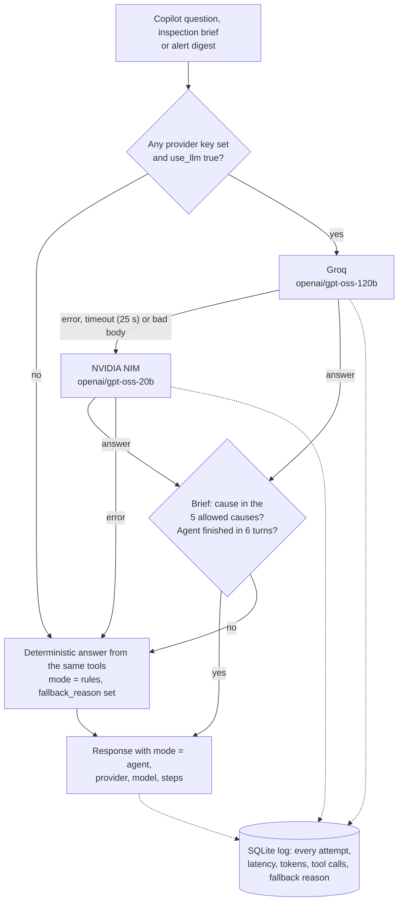
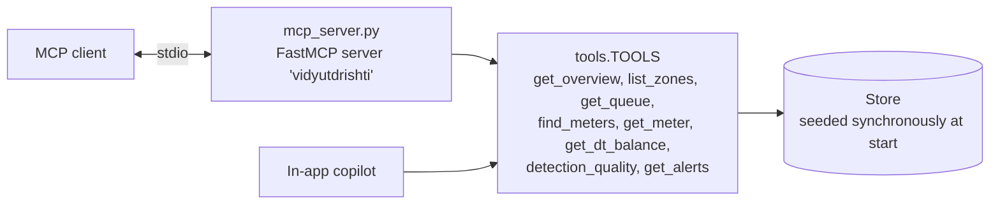
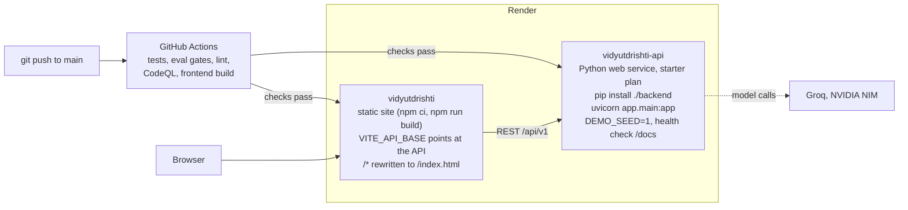
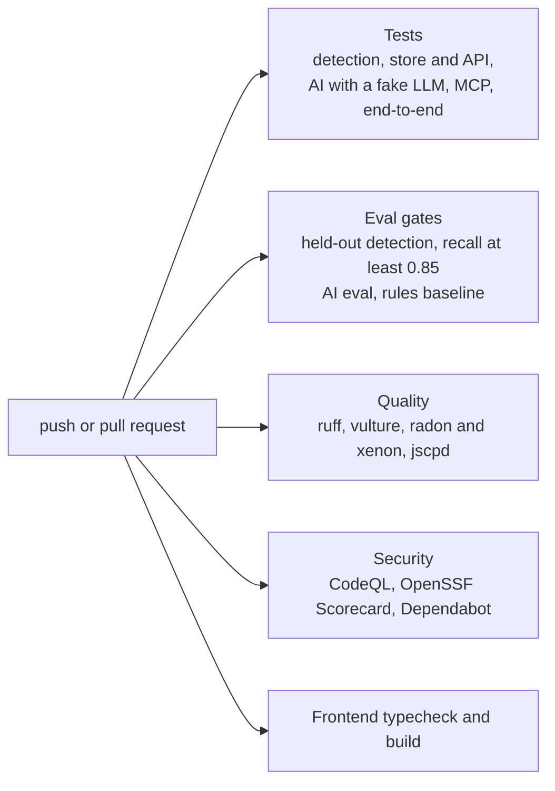

# Architecture

How VidyutDrishti is put together, and where each decision is made. This page is the picture; the reasoning behind it is in [HLD.md](HLD.md), the per-module detail is in [LLD.md](LLD.md) and the measured behaviour is in [results.md](results.md).

Everything described here runs on **simulated data**. There is no connection to a real meter-data, billing or SCADA system.

## 1. Components

One FastAPI process holds the data, the detector, the queue, the forecast and the AI features. A React dashboard reads it over REST. There is no database in the running system: readings live in an in-memory store, the AI call log lives in a small SQLite file, and the published evaluation results are JSON files read from disk.

Two rules shape the diagram:

- **The detector never calls a model.** Nothing in `detection/` imports anything from `ai/`. The AI layer reads detector output through `tools.py`, which reads only from the store.
- **Every number an AI feature states comes from a tool call.** The tools are read-only; the agents have no way to change a score, a queue position or a feedback record.

## 2. Data flow

### Startup and ingestion

With `DEMO_SEED=1` the API starts a background thread that builds the simulated network, loads it into the store, warms the queue cache and then computes how many days each theft took to be flagged. `/health` answers immediately; data endpoints answer 503 "still loading" until the readings are in. Readings can also be pushed in through `POST /api/v1/ingest/batch` and `/ingest/dt-batch`.

### A request

The store keeps one cache keyed by a data version number. Any new reading bumps the version and clears the cache, so scores are always for the data that is loaded and never stale.

## 3. Detection layers (L0 to L3)

A meter is scored every day against its own recent window. Four independent checks produce a strength between 0 and 1 and a one-sentence explanation. They are combined into a confidence in `score_meters`; the confidence decides the tier and whether the meter is flagged. Formulas are in [LLD.md](LLD.md#3-detection-layers-l0-to-l3).

What this buys:

- A drop at one meter is not enough. Unless the transformer balance confirms that the missing energy is still being drawn, the confidence tops out at 0.75 (MEDIUM). This is what separates a theft from a vacant house.
- L3 can only add at most 0.10 to a score, so the outlier model can never flag a meter on its own.
- "Inconclusive" is a first-class answer. When a meter's drop is smaller than the transformer's noise floor, L0 reports that it cannot tell, instead of reporting "fine".

## 4. AI layer and failover

Models are used for language work only: writing an inspection brief from the detector's evidence, answering questions about the network, and summarising alerts. They do not decide whether a meter is flagged.

Behaviour worth knowing:

- Failover is per call: `llm.chat` tries Groq, records an error row if it fails, then tries NIM. If both fail it returns nothing and the caller uses its rules path.
- With no key at all the app still works. The response says `mode: rules` and why (`no_llm_provider`).
- The inspection brief must pick one of five fixed causes (`hook_bypass`, `gradual_tampering`, `meter_stopped`, `genuine_drop`, `inconclusive`). An answer outside the set is discarded and the rules brief is used. The fixed set is what lets the brief be scored against ground truth.
- AI endpoints are limited to 20 model-backed requests per 10 minutes per visitor when a key is configured. Briefs are cached per meter and data version.
- Model ids are read from `GROQ_MODEL` and `NVIDIA_NIM_MODEL`. The defaults were changed to gpt-oss when the earlier Llama ids were retired (see [errorlog.md](errorlog.md)).

## 5. MCP server

The copilot's eight read-only tools are also served over the Model Context Protocol so an external client (an IDE, a desktop assistant, another agent) can query the network without the dashboard. `mcp_server.py` registers each entry in `tools.TOOLS` with the same description the copilot sees. It adds no logic and exposes nothing that writes.

The server seeds the demo network synchronously before it starts serving, so a client never sees an empty network.

## 6. Deployment on Render

`render.yaml` is a Render blueprint with two services. Both use `autoDeployTrigger: checksPass`, so a push to `main` deploys only after the GitHub checks pass. Secrets are declared with `sync: false` and entered in the Render dashboard.

Notes:

- The API holds all data in memory and re-seeds on every start, so a restart returns the same synthetic network rather than losing state. Feedback recorded through the UI is lost on restart.
- The backend image (`infra/Dockerfile.backend`) copies `evals/results` in, because `/metrics/evaluation` and `/ai/evals` read those JSON files.
- Locally, `docker-compose.yml` also starts TimescaleDB. It is used only by the original ingestion prototype; the API does not connect to it.
- The service runs on a small instance. That is why the pretrained forecaster (PyTorch) is opt-in and the shipped forecast is a simple seasonal mean.

## 7. Continuous checks

`scripts/validate.sh` runs the same set locally and prints a pass or fail line per stage.

## What is and is not wired

| Area | State |
|---|---|
| `detection/scoring.py`, `store.py`, `forecast/engine.py`, `evaluation/live.py`, `ai/*`, `api/*`, `mcp_server.py`, `demo_seed.py` | Live: this is what the API runs |
| `ingestion/`, `db/`, `features/`, `forecasting/` (Prophet), `risk/`, `feedback/`, `inspection/`, `audit/`, `detection/layer0..3_*.py`, `detection/confidence.py`, `detection/classifier.py`, `evaluation/{harness,leakage,backtest,baselines,metrics}.py` | Prototype from the first build, with prototype-grade tests under `logs/`. Not used by the API (the `detection/` and `evaluation/` package `__init__` files still import some of them, so they load but never run) |
| TimescaleDB schema in `db/migrations` | Prototype, used only by the ingestion CLI |
